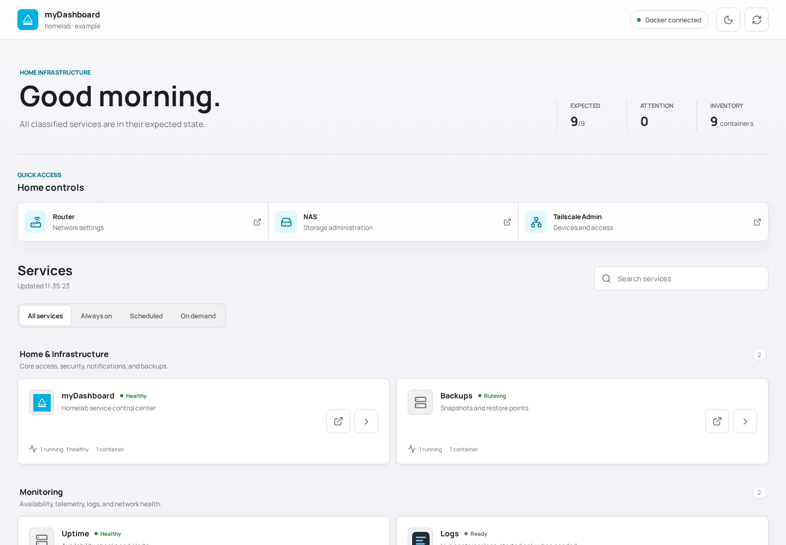
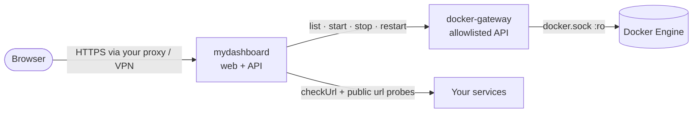

<div align="center">

# 🧭 myDashboard

**A calm operational dashboard for Docker Compose homelabs. Start what you need, see what runs, and never land on a 404 again.**

[](https://github.com/patbaumgartner/my-dashboard/actions/workflows/ci.yml)
[](https://github.com/patbaumgartner/my-dashboard/actions/workflows/release.yml)
[](LICENSE)
[](go.mod)
[](https://svelte.dev)
[](https://github.com/patbaumgartner/my-dashboard/pkgs/container/my-dashboard)

<picture>
  <source media="(prefers-color-scheme: dark)" srcset="docs/screenshot-dark.png">
  
</picture>

</div>

---

## Table of Contents

- [Why this project?](#why-this-project)
- [How it works](#how-it-works)
- [Project structure](#project-structure)
- [Quick start — GHCR](#quick-start--ghcr-recommended)
- [Building from source](#building-from-source)
- [Service manifest](#service-manifest)
- [Startup readiness](#startup-readiness)
- [Security model](#security-model)
- [Configuration reference](#configuration-reference)
- [Local development](#local-development)
- [Container images](#container-images)
- [Contributing](#contributing)
- [License](#license)

---

## Why this project?

A homelab grows one `docker-compose.yml` at a time. After a while `docker ps`
lists forty containers, half of them databases and sidecars, and nobody
remembers which tools are meant to be running right now.

myDashboard presents **Compose projects as services** instead of containers.
Each service has a lifecycle — always on, scheduled to a time window, or on
demand — and the dashboard tells you at a glance whether reality matches that
intent. On-demand tools (diagram editors, PDF utilities, log viewers) can be
started from the dashboard and stopped again when you are done, which keeps a
small NAS fast and quiet.

The part that matters most in practice: when you press **Start → Open**, the
dashboard waits until the app is really reachable through your reverse proxy
before it sends you there. No more landing on Traefik's `404 page not found`
because the container was up but its router was not yet.

---

## How it works



- **One image, two modes.** The same image runs as the web application and as
  a tiny Docker API gateway. Only the gateway mounts `docker.sock`, on an
  internal network with no route to the outside.
- **Manifest-driven.** `config/services.json` describes services, categories,
  quick links and branding. Compose projects missing from the manifest still
  show up under *Discovered*.
- **Honest availability.** A service is *available* only when its backend
  `checkUrl` **and** its browser-facing `url` both answer.

---

## Project structure

```
my-dashboard/
├── cmd/mydashboard/        # Entry point: web app, gateway, healthchecks, version
├── internal/dashboard/     # Manifest, Docker client & gateway, availability, HTTP API
├── src/                    # Svelte 5 + TypeScript frontend (App, StartupGate, theme)
├── public/                 # Logo, web manifest, example icons
├── config/
│   └── services.example.json   # Baked into the image as the default manifest
├── Dockerfile              # Multi-stage, cross-compiled, distroless, non-root
├── docker-compose.yml      # Production: pulls ghcr.io/patbaumgartner/my-dashboard
└── docker-compose.build.yml    # Override that builds from source
```

---

## Quick start — GHCR (recommended)

```bash
# 1. Clone the repository (only the compose and example files are needed)
git clone https://github.com/patbaumgartner/my-dashboard.git
cd my-dashboard

# 2. Create your configuration
cp .env.example .env
cp config/services.example.json config/services.json    # describe your services
#    and point MYDASHBOARD_MANIFEST_FILE in .env at it

# 3. Pull the pre-built image and run
docker compose pull
docker compose up -d
```

Open <http://127.0.0.1:8080>. The port is bound to loopback on purpose: the
dashboard has no login and can stop containers. Publish it through a reverse
proxy or VPN you trust (see [Security model](#security-model)).

To pin a release instead of `latest`, set `VERSION=0.1.0` in `.env`.

---

## Building from source

```bash
docker compose -f docker-compose.yml -f docker-compose.build.yml up -d --build
```

The Dockerfile runs `svelte-check`, the Vite build and the Go tests during the
build, then cross-compiles the binary for the target platform, so multi-arch
builds need no QEMU emulation.

---

## Service manifest

The manifest is a single JSON file. Unknown fields are rejected, and the
dashboard refuses to start on an invalid manifest, so typos fail loudly.
[`config/services.example.json`](config/services.example.json) is a complete,
working example.

| Section | Purpose |
|---|---|
| `site` | Optional branding: `name`, `subtitle`, `description` and an IANA `timeZone` for schedule windows (empty = browser's zone) |
| `lifecycleFilters` | The filter tabs shown above the service list |
| `categories` | Groups services are shown in (`infrastructure`, `monitoring`, `media`, `tools`, `automation`, `discovered`) |
| `quickLinks` | Shortcut tiles (`icon` is a [Lucide](https://lucide.dev) name such as `router`) |
| `footer` | Optional footer: `year`, `name`, `url`, `message` |
| `services` | One entry per Compose project |

A service entry:

| Field | Description |
|---|---|
| `id`, `name`, `description` | Identity and text shown in the UI |
| `project` | The `com.docker.compose.project` label to match containers |
| `category`, `lifecycle` | One of the categories above; `always-on`, `scheduled` or `on-demand` |
| `url` | Browser-facing HTTPS URL (what **Open** navigates to) |
| `checkUrl` | Internal backend health URL, probed from the dashboard container |
| `icon` | Same-origin path, e.g. `/icons/excalidraw.svg` (mount your icons at `/app/public/icons`) |
| `control` | `"power"` enables Start/Stop/Restart for single-container on-demand projects |
| `startupTimeoutSeconds` | How long the startup page waits before offering **Keep waiting** (10–600) |
| `schedule`, `windowStart`, `windowEnd` | Display text and `HH:MM` window for `scheduled` services; windows may cross midnight |
| `hidden` | Hide the service from the dashboard |

The controller resolves containers from the live Compose project, so it can
only start and stop containers that already exist — it never creates one.
Provision a stopped container once with `docker compose create`; otherwise the
service shows **Not created** instead of a Start button. Multi-container
projects are rejected because they need a future Compose-aware controller.

---

## Startup readiness

`checkUrl` is an additional backend check, not a replacement for `url`. Both
must answer before the dashboard enables **Open** or finishes a start/restart:

- HTTP 404 and 5xx keep a service unavailable (a healthy container can still
  have no proxy router yet). 401/403 count as a reachable route.
- Same-host redirects are followed, so a redirect into a missing page is not
  ready.
- Backend and public checks run in parallel; one full status read is bounded
  to 10 seconds of route checks so a hanging service cannot stall the page.

**Open** goes through a waiting page that requires three consecutive successful
checks before redirecting (one confirming check if the service was already up).
Failed requests reset the count, a timeout stops polling until **Keep waiting**
is selected, and a failed route never triggers a redirect. If Docker reports the
service stopped twice in a row, the page says so, keeps watching at a slower
pace, and resumes if the service is started elsewhere.

If the dashboard container cannot resolve your public host name (for example
with userspace Tailscale on Synology DSM), map it to the host with
`extra_hosts: ["your.host.name:host-gateway"]`. TLS and host-name verification
stay intact.

---

## Security model

The web application never mounts `docker.sock`. The gateway does, and runs with
a read-only filesystem, no Linux capabilities, `no-new-privileges`, a non-root
uid, and no attachment to any public network.

The `:ro` flag on the socket protects the inode, not the API — anything that can
talk to `docker.sock` controls the daemon. The real boundary is the gateway's
route allowlist: exactly four operations (list containers, start, stop,
restart). Before an action reaches Docker the gateway resolves the container ID
itself and verifies its Compose project against manifest entries with
`"control": "power"`. Everything else returns 404/405. Container listings are
reduced to id, names, image, state, status and the Compose project label; all
other labels are dropped because they can carry secrets such as Traefik
`basicauth` hashes.

The dashboard API:

- `GET /api/services`
- `GET /api/services/{id}/availability`
- `POST /api/services/{id}/actions/{start|stop|restart}`
- `GET /healthz`

Actions must be same-origin and carry `X-MyDashboard-Action: confirm`. That
stops cross-site requests from a victim's browser, not a direct attacker, so
**the network boundary carries the weight**: expose the dashboard only on a
VPN/tailnet or behind an allowlist. With Traefik and userspace Tailscale, for
example, an `ipallowlist` of `127.0.0.1/32` admits Tailscale clients only.

A strict Content Security Policy only allows same-origin scripts, styles and
images. See [SECURITY.md](SECURITY.md) to report a vulnerability.

---

## Configuration reference

| Variable | Default | Used by | Description |
|---|---|---|---|
| `MYDASHBOARD_MANIFEST` | `/app/config/services.json` | both | Manifest path inside the container |
| `MYDASHBOARD_DOCKER_ENDPOINT` | `http://docker-gateway:2375` | web | Gateway URL |
| `MYDASHBOARD_STATIC_DIR` | `/app/public` | web | Built frontend directory |
| `MYDASHBOARD_ADDRESS` | `:8080` | web | Listen address |
| `MYDASHBOARD_DOCKER_SOCKET` | `/var/run/docker.sock` | gateway | Docker socket path |
| `MYDASHBOARD_GATEWAY_ADDRESS` | `:2375` | gateway | Gateway listen address |

Compose-only variables in `.env`: `VERSION`, `MYDASHBOARD_PORT`,
`MYDASHBOARD_MANIFEST_FILE`, `MYDASHBOARD_ICONS_DIR`.

Container commands: *(none)* web app · `gateway` · `healthcheck` ·
`gateway-healthcheck` · `version`.

---

## Local development

Requirements: Go (version in [`go.mod`](go.mod)), Node.js 24, Docker.

```bash
# Gateway against your local Docker socket
MYDASHBOARD_MANIFEST=./config/services.example.json \
MYDASHBOARD_DOCKER_SOCKET=/var/run/docker.sock \
MYDASHBOARD_GATEWAY_ADDRESS=:2375 \
go run ./cmd/mydashboard gateway

# Web application against that gateway
MYDASHBOARD_MANIFEST=./config/services.example.json \
MYDASHBOARD_STATIC_DIR=./dist \
MYDASHBOARD_DOCKER_ENDPOINT=http://127.0.0.1:2375 \
go run ./cmd/mydashboard

# Frontend with hot reload (proxies /api to the Go service)
npm ci
npm run dev
```

Run the same gates as CI before opening a pull request:

```bash
gofmt -l . && go vet ./... && go test -race ./...
npm run check && npm run build && npm audit --audit-level=high
docker build -t my-dashboard:dev .
```

---

## Container images

Images are published to GitHub Container Registry for `linux/amd64` and
`linux/arm64`, with SBOM and signed build provenance.

| Tag | Moves when | Use for |
|---|---|---|
| `X.Y.Z` | Never (immutable release) | Production — pin this |
| `X.Y` | Each patch release | Automatic patch updates |
| `latest` | Each final release | Quick start |
| `main`, `sha-<short>` | Each push to `main` | Testing unreleased changes |

Verify provenance:

```bash
gh attestation verify oci://ghcr.io/patbaumgartner/my-dashboard:0.1.0 --owner patbaumgartner
```

Releases are cut by pushing a `vX.Y.Z` tag that matches `package.json`'s
version; the release workflow verifies, builds, pushes and publishes the GitHub
release.

---

## Contributing

Contributions are welcome. Read [CONTRIBUTING.md](CONTRIBUTING.md) for the
workflow and conventions, and please follow the
[Code of Conduct](CODE_OF_CONDUCT.md).

---

## License

[Apache License 2.0](LICENSE)
